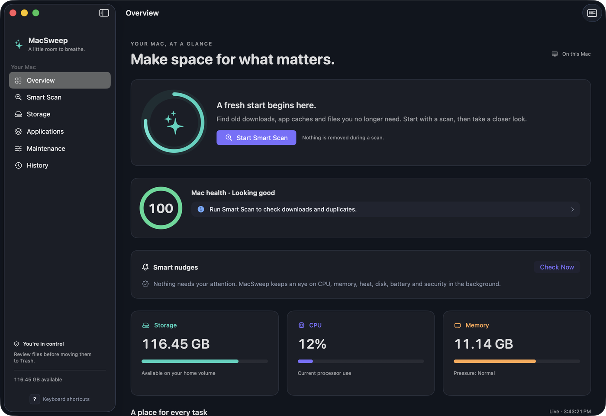
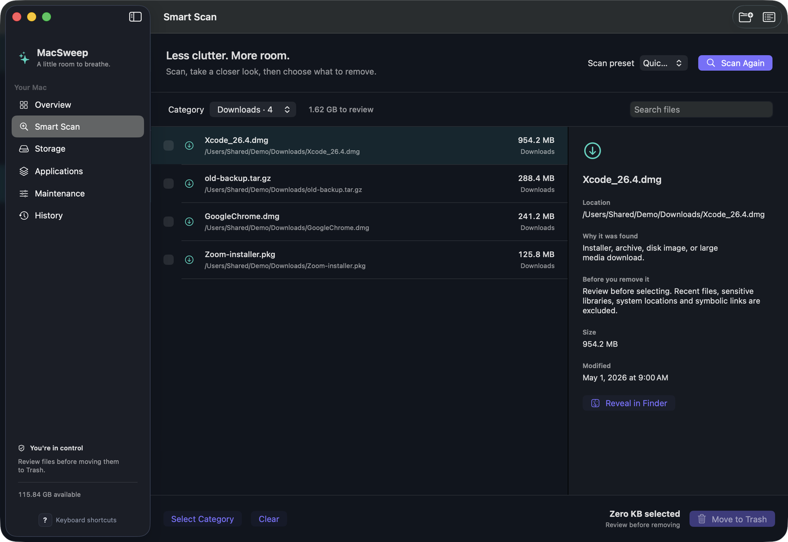

# MacSweep

A local-first cleaner and system monitor for Mac.

[](https://github.com/asjames18/mac-cleanup/releases/latest)


[](LICENSE)

## Overview

MacSweep is a native SwiftUI app for scanning storage, reviewing caches and leftover files, managing applications, and checking startup items. It is self-contained: no account, no extra software, and no network service is required to use it. Scans never delete files on their own. Every cleanup asks for confirmation first and moves items to the Trash, so you can restore them in Finder.

## Features

- **Smart Scan** with Quick, Deep, Developer, and Duplicates Only presets. Review old downloads, caches, logs, DerivedData, temporary files, large files, and duplicate groups. Add custom folders, filter by category, inspect details, and reveal items in Finder.
- **Storage** map of common folders and folders you add, ranked by size, with Finder shortcuts. Counts cover readable, non-protected content and may exclude packages and inaccessible files.
- **Applications** inventory from `/Applications`, `~/Applications`, and `/System/Applications`. Search apps, find associated support files, and uninstall an app with the support files you explicitly select. Running apps, Apple apps, MacSweep itself, and symlinked app bundles are blocked.
- **Maintenance** view of startup plist definitions from user and local LaunchAgents and LaunchDaemons, plus shortcuts to Apple's Login Items, Storage, Software Update, Activity Monitor, and Disk Utility.
- **History** of cleanup attempts, stored locally, with restore through Finder Trash.
- **Menu bar** helper that shares live CPU, memory, and disk readings. Optional smart nudges are limited to three banners a day and stay quiet overnight (10 PM to 8 AM by default). You can also register MacSweep to launch at login.
- **Optional AI recommendations** are off by default. Nothing leaves the Mac unless you turn them on.

## Screenshots

| Overview | Smart Scan results |
| --- | --- |
|  |  |

## Download

Get MacSweep 2.0 from the [latest GitHub release](https://github.com/asjames18/mac-cleanup/releases/latest), or from the [Melanated in Tech apps page](https://melanatedintech.com/apps).

- [MacSweep-2.0-macOS.dmg](https://github.com/asjames18/mac-cleanup/releases/download/v2.0/MacSweep-2.0-macOS.dmg)
- [MacSweep-2.0-macOS.zip](https://github.com/asjames18/mac-cleanup/releases/download/v2.0/MacSweep-2.0-macOS.zip)

Checksum files (`.sha256`) are attached to the same release.

## Install

The download is a universal app (Apple Silicon and Intel) with an ad-hoc signature. It is not notarized, so macOS will block it until you allow it.

1. Open the `.dmg` and drag MacSweep to Applications (or unzip the `.zip` and move the app to Applications).
2. Open the app from Applications. macOS will say it can't verify the app is free of malware. Click **Done**.
3. Open **System Settings > Privacy & Security**, scroll to **Security**, and click **Open Anyway** next to MacSweep. Confirm with your password or Touch ID, then click **Open Anyway** again.
4. The app opens; after that it opens normally.

If Open Anyway does not appear, run this in Terminal:

```sh
xattr -dr com.apple.quarantine /Applications/MacSweep.app
```

## Requirements

- macOS 13 Ventura or later
- An Apple Silicon or Intel Mac (the release is a universal binary)
- No other software is required
- For fuller scans (including system crash reports and every startup item), grant MacSweep **Full Disk Access** in System Settings > Privacy & Security when asked. MacSweep only reads; it does not change privacy settings itself.

Tested on an Intel Mac.

## Usage

Open MacSweep from Applications. The dashboard shows live CPU use, estimated memory use, kernel memory pressure, and available space on your home volume. Use the sidebar to open Smart Scan, Storage, Applications, Maintenance, History, or Settings.

Start with a scan, review the candidates (everything starts unselected), then confirm any cleanup. System roots, sensitive user libraries, cloud-storage paths, symbolic links, and recently modified cleanup files are protected. Respond to any macOS folder-access prompt, then retry the scan if a location was skipped.

## Privacy

MacSweep is local-first. Cleanup history is stored on your Mac under `~/Library/Application Support/MacSweep/History`, with private permissions. There is no account and no required network service. Optional AI recommendations stay off until you enable them; nothing is sent off the Mac unless you turn that on.

## Verify the download

From Terminal, in the folder that contains the file you downloaded:

```sh
shasum -a 256 MacSweep-2.0-macOS.dmg
shasum -a 256 MacSweep-2.0-macOS.zip
```

The SHA-256 values should match the release and the `.sha256` files next to the downloads:

| File | SHA-256 |
| --- | --- |
| `MacSweep-2.0-macOS.zip` | `5c2787ed988227e0bccd67e929f4af73328db9c45b6651d7a631a4fb1321dc31` |
| `MacSweep-2.0-macOS.dmg` | `10a6dc823f02f2086446bf1ec3949097a8c093b10e2f95c6ef187b4b3cc8543a` |

## Build from source

You need macOS 13 or later and a Swift 6 toolchain (this package declares `swift-tools-version: 6.0`).

```sh
./scripts/build-app.sh
```

That builds a universal (arm64 + x86_64), ad-hoc-signed `build/MacSweep.app`. Set `UNIVERSAL=0` for a host-only build. To package a `.zip` and `.dmg`:

```sh
./scripts/package-release.sh build/MacSweep.app 2.0
```

`./script/build_and_run.sh` builds the app and opens it. Other modes: `--verify`, `--debug`, `--logs`.

## Troubleshooting

- **macOS says the app can't be verified.** Use Open Anyway in System Settings > Privacy & Security, or the `xattr` command in [Install](#install). Right-click > Open is not a reliable workaround on current macOS.
- **A folder was skipped or a scan looks incomplete.** Approve the macOS folder-access prompt, then scan again. For protected locations, review MacSweep under System Settings > Privacy & Security > Files and Folders or Full Disk Access.
- **Startup items or crash reports look incomplete.** Grant Full Disk Access as described in [Requirements](#requirements).

## License

This project is licensed under the [MIT License](LICENSE). Copyright (c) 2026 Antonio James.

## Made by

[Antonio James](https://antoniojames.dev) / [Melanated in Tech](https://melanatedintech.com)
