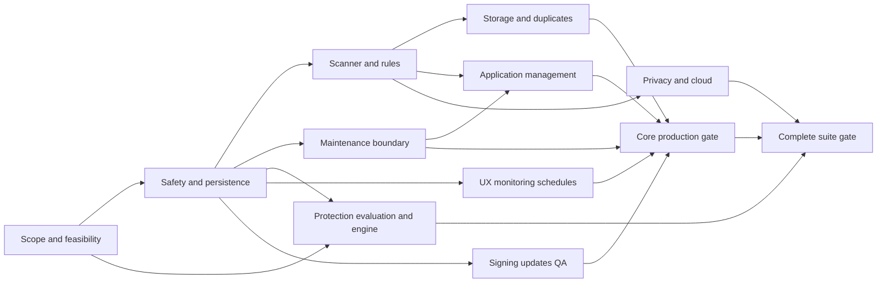

# MacSweep Complete Suite Development Plan

This is the master roadmap; execute one milestone at a time with its acceptance gate. Do not treat proposed platform/vendor integrations as verified APIs.

**Goal:** Turn the existing local MacSweep app into a supported, production-quality Mac-care suite with clearly measured cleanup, application-management, maintenance, privacy and protection capabilities.

**Architecture:** Keep the native UI and extract a reusable core containing scan providers, typed operation plans and a durable journal. Put permissions, privileged operations, malware scanning, updates and cloud adapters behind separate boundaries so one failing or unavailable capability cannot compromise the rest of the app.

**Tech Stack:** Swift 6, SwiftUI, AppKit, Foundation, SQLite, XCTest/XCUITest, XPC and ServiceManagement where needed; evaluate Sparkle for self-updates and a maintained malware engine. Add an Xcode app project for helpers/extensions while retaining SwiftPM core tests.

**Spec:** [Complete-suite product specification](../../product/macsweep-product-spec.md).

**Baseline:** local commit `f6b8400`, September 12, 2026. Prior verification recorded 28 passing tests, successful release launch and an ad-hoc-signed bundle. This planning pass inspected code and documentation; it did not rerun that suite or perform any cleanup.

## Global Constraints

The twelve constraints in the product specification are binding. In particular: macOS 13 remains the current floor until an explicit tested support decision; direct distribution comes first; scans never delete; deletion requires a concrete preview; unknown coverage and unsupported operations stay visible; permissions cannot be bypassed; new dependencies require review; and user data stays local by default. The scope definitions in that document distinguish core production, complete suite and optional expanded real-time protection.

## 1. What exists and what is missing

| Area | Current implementation | Work needed |
|---|---|---|
| App shell | Native sidebar, dashboard, settings, menu bar | Onboarding, accessible state flows, history, per-module navigation, progress and help |
| Scanner | Four presets, background work, cancellation guards | Incremental provider pipeline, coverage accounting, persisted exclusions, bounded parallel work and measurable progress |
| Cleanup rules | Downloads, caches, logs, temporary files, DerivedData, custom folders | Versioned/tested rules, evidence and risk levels, application state checks, deeper developer adapters |
| File safety | Root/sensitive-path/link protection, recent-file checks | Resource identity and volume-aware comparisons, scan-to-action change detection, crash recovery and restore |
| Duplicates | Logical-size/SHA-256 matching, retained copy, action-time rehash | Stable identity, hard-link handling, scalable hash cache, user retention rules and larger-volume tests |
| Storage | Ranked readable folders | Interactive folder tree/treemap, separate traversal policy, APFS/cloud accounting and partial-result reporting |
| Apps | Top-level app discovery and advisory support matches | Ownership evidence graph, nested app discovery, reset/batch removal, extension handling and supported updater catalog |
| Startup/maintenance | Read-only plist inventory and Apple tool shortcuts | Capability-aware direct operations, reversible supported changes, narrowly authorized helper where justified |
| Monitoring | CPU, memory estimate/pressure, disk, uptime | History, configurable budgets, supported additional metrics and actionable alerts |
| Privacy/cloud | No implementation | Browser adapters and cloud-local-space management with separate data-loss semantics |
| Security | No malware engine | Engine selection, definitions, scanning, quarantine, restore, detection evaluation; optional real-time extension |
| Delivery | Local shell-built app, ad-hoc signing | Production identity, native targets, notarization, signed updater, CI, release/support operations |

Code-specific foundation work: `ProtectionRules.contains` currently lowercases all paths; this is conservative for protection but unsuitable as universal identity on case-sensitive volumes. `CleanerScanner.scan` runs storage analysis before every preset. The storage reader reuses cleanup exclusions and skips packages, so its totals are intentionally incomplete. `AppModel` still owns dialogs, jobs and state together. The operation result contains original URLs but no durable Trash-destination journal. These are starting points to improve, not claims that the existing build already provides production guarantees.

## 2. Product comparison and the meaning of “full”

MacPaw's public tool catalog covers cleanup, application management, privacy/protection and performance functions, as well as duplicate and similar-image review. These categories establish the comparison boundary; implementation and validation requirements below are MacSweep design proposals. [Current tool catalog](https://macpaw.com/support/cleanmymac/knowledgebase/my-tools).

Cloud management is also a distinct reference capability. MacSweep's plan includes it explicitly instead of counting generic folder deletion as cloud support. [MacPaw cloud feature introduction](https://macpaw.com/news/macpaw-introduces-cloud-cleanup).

A feature is complete only when its actual result, permission behavior, failure path and recovery path work. Coverage is stated per browser, provider, app family, OS version and action. No product can promise detection of every malicious file or ownership of every support file. Unsupported integrations remain labeled unavailable, rather than silently routed through a broad deletion rule.

Additional scope dispositions prevent broad marketing language from hiding unsupported corners:

| Adjacent capability | Planned treatment |
|---|---|
| Mail attachments | A separate version-tested adapter after core safety; until available, excluded and clearly listed as unsupported. Never delete Mail databases or imply local deletion preserves server messages without proving provider behavior. |
| Browser/app extensions | Inventory and ownership evidence within P4; remove only through supported vendor/system mechanisms. Unsupported extension removal remains external management. |
| Time Machine snapshots | P5 feasibility and a separate advanced destructive flow; never a routine cleanup suggestion. |
| Wi-Fi histories / application permissions | Guidance or supported system management only. No direct system-database manipulation. |
| “Free RAM,” generic performance score, SSD secure erase | Deliberately excluded claims/features. Surface measured pressure and concrete actions; do not promise physical secure erasure through ordinary file deletion. |
| Remote cloud deletion | Separate future scoped feature; complete-suite cloud support initially means supported local download eviction, explicitly stated in the coverage matrix. |

Consequently, “complete suite” in this plan means the declared MacSweep capability set, not identical coverage to every CleanMyMac edition. If exact feature-for-feature parity is required, these exclusions become additional gated milestones and the estimates must be revised before commitment.

## 3. Architecture and file ownership

```text
MacSweep UI (SwiftUI/AppKit)
  ├─ Feature stores + JobCoordinator
  ├─ AccessManager + CapabilityRegistry
  └─ MacSweepCore (Swift package)
       ├─ ScanCoordinator → Cleanup / Storage / Duplicate / App providers
       ├─ FileIdentity + Coverage + versioned RuleCatalog
       ├─ OperationPlanner → immutable reviewed OperationPlan
       └─ OperationExecutor → OperationJournal → restore/conflict flow

Separate boundaries:
  MaintenanceClient → authenticated XPC → narrow signed helper, if necessary
  ProtectionClient  → isolated scanner → maintained DetectionProvider
  Optional system extension → bounded event queue → protection service
  SelfUpdater / AppUpdateCatalog / CloudAdapters → disclosed network access
```

The UI must never construct shell command text. A helper accepts typed allowlisted requests and verifies the calling app, target identity, authorization and scope itself. It does not trust a path or “already authorized” flag supplied by the UI. Keep the malware worker separate from the maintenance helper.

| Boundary | Proposed files/targets | Responsibility |
|---|---|---|
| Shared domain | `Sources/MacSweepCore/Models/` | Scan, item identity, coverage, rule, operation and result types |
| Read-only scan | `Sources/MacSweepCore/Scanning/` | Traversal, provider scheduling, throttling, cancellation and caching |
| Safety/execution | `Sources/MacSweepCore/Operations/` | Validate reviewed plans, journal intent/result, Trash/restore and conflicts |
| Local persistence | `Sources/MacSweepCore/Persistence/` | SQLite migrations, bounded metadata/history and corruption recovery |
| Platform access | `Sources/MacSweep/Services/AccessManager.swift` | User grants, selected roots, stale bookmarks where applicable, access guidance |
| UI state | `Sources/MacSweep/Stores/` | Feature stores and job progress; gradually replace AppModel responsibilities |
| Maintenance | `Sources/MacSweepMaintenanceHelper/`, `Sources/MacSweepMaintenanceProtocol/` | Optional signed narrowly scoped service and shared request definitions |
| Protection | `Sources/MacSweepProtection/`, `Sources/MacSweepProtectionExtension/` | Provider adapter, quarantine and separately gated real-time integration |
| Native packaging | `MacSweep.xcodeproj`, `Config/`, `Release/` | App/helper/extension identities, entitlements, signing and distribution |
| Tests | `Tests/MacSweepCoreTests/`, `UITests/`, `Tests/Fixtures/` | Pure tests, real-volume fixtures and end-to-end user flows |

SQLite is the proposed metadata/journal store so the existing macOS 13 target is not accidentally raised. Store rule versions, scan summaries, exclusions and operation records; do not store file contents. Keep private keys and cloud tokens in Keychain. Default history retention: 90 days, configurable to 7/30/90 days or until manually cleared. Quarantined contents require an explicit separate retention policy and never disappear because ordinary scan history expired.

The existing single executable target becomes an app consuming a core library. Preserve old entry points through adapters while moving one responsibility per change. Do not rewrite the whole UI before correctness and persistence are established.

## 4. Shared operation contract

The invariant is **discover → assess → review → revalidate → perform → record → recover**.

An operation plan contains a UUID, originating scan ID, rule version, exact resource identities, expected metadata/content fingerprints, action kind, permission requirements and a displayable consequence for each target. A confirmation applies only to that immutable plan. Editing selection creates a new plan. A changed resource produces `needsRescan`; it is not silently reinterpreted as a fresh target.

Use resource/volume identifiers when available, plus file-system metadata and safe path traversal. Preserve original spelling and use a volume's case-sensitivity rules; never use global lowercase paths as file identity. Distinguish hard links, APFS clones, sparse files, symlinks and mount points. Report measured candidate bytes separately from observed post-operation free-space change.

Persist intent before starting each item and its outcome immediately afterward. A crashed operation reconciles journal state against the actual source and destination on next launch. Do not claim atomic multi-file deletion or perfect rollback. Trash restore refuses overwrite collisions and supports a user-selected alternate destination. If the user emptied Trash, recovery is explicitly unavailable.

No generic cleanup rule operates on Mail databases, password stores, photo/music libraries, cloud placeholders, Time Machine backups or arbitrary system data. Such capabilities need independent, version-specific adapters and acceptance tests.

## 5. Milestones and task backlog

Effort estimates are preliminary **engineering-weeks**, including implementation, code review and automated tests. They are not elapsed-time commitments or guarantees of third-party approval. QA/design participation and external waiting time are addressed in section 8.

### P0 — Scope, compatibility and feasibility (2–3 engineering-weeks)

Dependencies: none. Owner: technical lead with product/security input.

- [ ] **P0.1:** Create `docs/product/capability-matrix.md` mapping R01–R16 to built/validated/limited/blocked/excluded, OS availability and required permissions. Select a testable initial browser/app/provider coverage list.
- [ ] **P0.2:** Confirm shipping support for macOS 13/14/15/26 on available supported hardware; document any explicit minimum-version change. Test Apple Silicon and Intel where supported, including a standard non-admin account.
- [ ] **P0.3:** Produce `docs/architecture/platform-feasibility.md`: supported startup controls, TCC behavior, XPC caller authentication, helper lifecycle, app updater feasibility, browser data access and provider-local eviction.
- [ ] **P0.4:** Start malware-engine evaluation and Apple Endpoint Security entitlement planning. Score supported Mac threats, SDK architecture, definition freshness, privacy, offline behavior, false positives, redistribution rights, cost and vendor support. No vendor purchase is authorized by this document.
- [ ] **P0.5:** Create `docs/testing/benchmark-protocol.md`; baseline scan latency, cancellation, memory and idle CPU on small/large fixtures.

**Exit:** concrete capability/support matrix, chosen direct-distribution architecture, named owner for every external dependency, and feasibility decisions with evidence. A restricted feature stays blocked if no supported implementation exists.

### P1 — File safety, permissions and persistent operations (4–6 engineering-weeks)

Dependencies: P0. Owner: core engineer. This is the next implementation milestone.

- [ ] **P1.1:** Extract `MacSweepCore` in `Package.swift`; move pure models and rules behind adapters. Keep existing 28 tests and startup flow working.
- [ ] **P1.2:** Implement `FileIdentity.swift`, `VolumeCapabilities.swift` and `FileAccess.swift`. Test case-sensitive/case-insensitive APFS, Unicode names, hard links, symlink replacement and mount boundaries. Reassess protection separately from identity equality.
- [ ] **P1.3:** Implement `AccessManager.swift` and onboarding/access-status views. Distinguish not requested, allowed, denied, stale grant, unavailable volume and unsupported capability. Persist custom roots and exclusions. Request only relevant access; do not claim Full Disk Access bypasses all protections.
- [ ] **P1.4:** Implement `OperationPlan.swift`, `OperationExecutor.swift` and `OperationJournal.swift`. Record real Trash destinations, per-item outcomes, conflicts, cancellation-before-next-item and crash reconciliation.
- [ ] **P1.5:** Implement `HistoryStore.swift`, `HistoryView.swift` and `RestoreView.swift`; restore temporary test fixtures, handle missing Trash objects and never overwrite an existing destination.
- [ ] **P1.6:** Split AppModel into a coordinator and focused scan/operation stores. Replace blocking modal chains with window-attached review/result flows without weakening confirmation semantics.

**Tests:** `swift test --filter FileIdentityTests`, `OperationPlanTests`, `OperationRecoveryTests`, `PermissionStateTests`; then full `swift test`. New tests should fail for their missing behavior before implementation. Mutation integration tests operate only on disposable fixtures/volumes.

**Exit:** changed identities fail closed; scan grants/exclusions survive relaunch; a forced termination between intent and result yields an honest recoverable/ambiguous journal state; restore collisions preserve both items; no mutation reaches an unreviewed target.

### P2 — Scalable Smart Care and cleanup rules (6–9 engineering-weeks)

Dependencies: P1. Owner: core engineer.

- [ ] **P2.1:** Add `ScanCoordinator.swift`, `ScanProvider.swift`, `ScanEvent.swift` and `ScanCoverage.swift`. Stream batches and stage progress; distinguish completed, canceled, partial, denied and failed results. Use separate volume-aware queues, bounded hashing concurrency and operation IDs.
- [ ] **P2.2:** Separate read-only inventory policy from cleanup eligibility. Quick Scan must not force a full home-storage traversal. Scope presets explicitly and keep totals deduplicated across providers.
- [ ] **P2.3:** Add bundled `Resources/CleanupRules/` schemas with stable IDs, evidence, risk, minimum age, OS/app version scope, app-closure requirements and protected exclusions. Ship rules with signed app releases initially; remotely updated rules require their own signed/versioned channel.
- [ ] **P2.4:** Expand supported caches/logs/installers and developer adapters: DerivedData, reviewed simulator artifacts and selected build/package caches. Every adapter documents rebuild/download costs and uses official tool-mediated cleanup where appropriate.
- [ ] **P2.5:** Add per-rule/user exclusions, candidate explanation, retained-copy badges and per-volume coverage. An unreadable directory or read failure must not count as successfully scanned.
- [ ] **P2.6:** Add an advanced Trash-emptying flow only after P1 restore/history are stable. This permanently destroys recovery, is excluded from Smart Care, and requires a distinct explicit confirmation. Keep snapshot removal in P5, never general trash rules.

**Tests:** provider cancellation/race tests, rule fixture corpus, unreadable roots, active-app files, broken links, changing volumes, 100k/1M-entry inventories and overlapping selections.

**Exit:** no post-cancel result publication; progress is honest; all rules have positive/negative fixtures; partial scans explain missing coverage; candidate totals never double-count a path or its selected ancestor.

### P3 — Storage, duplicates and similar images (4–7 engineering-weeks)

Dependencies: P1; shared P2 scanner contracts. Owner: storage/UI engineer.

- [ ] **P3.1:** Add `StorageIndex.swift`, `StorageTreeView.swift` and `StorageTreemapView.swift`. Drill down by folder/volume; offer accessible list alternatives. Account for package contents when measuring while keeping cleanup policy separate.
- [ ] **P3.2:** Display logical bytes, allocated estimates, file counts, partial coverage and purgeable/available labels. Do not sum APFS shared allocation as guaranteed reclaimable space.
- [ ] **P3.3:** Add `DuplicateIndex.swift` and `HashCache.swift`, keyed by stable identity plus size/modification information. Invalidate on changes and rehash before action. Exclude hard-linked instances from “space saved” claims; keep retained copies visible.
- [ ] **P3.4:** Add `SimilarImageProvider.swift` and a comparison UI using locally generated thumbnails/features. Investigate image orientation, formats, memory use and perceptual thresholds on a labeled corpus. Keep Photos libraries excluded until a separately authorized Photos integration is designed.
- [ ] **P3.5:** Add move-to-folder as a reviewed operation with cross-volume copy verification and destination-conflict handling; no partial-copy source deletion.

**Tests:** compressed/sparse duplicates, same name/different data, clones/hard links, changed retained/selected copies, cloud placeholders, large images, damaged images and interrupted cross-volume moves.

**Exit:** exact and similar matches cannot be confused; retention survives cross-category selection; drill-down reconciles with readable inventory; image similarity never auto-selects deletion.

### P4 — Application ownership, removal, reset and updates (7–11 engineering-weeks)

Dependencies: P1/P2; helper-dependent operations also require P5's authorization boundary. Owner: apps engineer.

- [ ] **P4.1:** Add `ApplicationInventory.swift` and `ApplicationIdentity.swift`: supported nested app locations, bundle/team identity, version, architecture, running state and multiple installations.
- [ ] **P4.2:** Replace name-only attribution with `AppOwnershipGraph.swift`. Combine bundle IDs, signed team information, documented app-group/container metadata, receipts and tested app rules. Rank evidence as verified/shared/advisory/unknown. Shared or unknown data stays unselected.
- [ ] **P4.3:** Add batch uninstall and app-reset plans in `ApplicationOperationPlanner.swift`. Preview app data separately from reconstructible caches; recheck running processes and identity. A reset explicitly explains preference/account-data effects. Require vendor uninstallers for unsupported protected components.
- [ ] **P4.4:** Add `AppUpdateCatalog.swift` and source adapters. Pilot a published list of ten supported apps; expand only with fixtures and verified publisher identity. Distinguish MacSweep self-updates from third-party updates.
- [ ] **P4.5:** Show available updates, source and release notes; install only supported formats with verified publisher identity, eligibility and post-install version checks. Route App Store and unsupported package-manager apps to their owning updater. Handle signatures, rollback constraints and interrupted replacement.

**Tests:** shared app-group data, unrelated names, unsigned apps, renamed bundles, duplicate installs, running helper processes, signature mismatches, stale catalog entries, downgrade attempts and interrupted updates.

**Exit:** the tested catalog documents coverage; no support-file match is represented as certain ownership without evidence; unsupported apps have an explicit management route; app updates cannot silently install an unverified publisher.

### P5 — Startup controls and meaningful maintenance (6–9 engineering-weeks)

Dependencies: P0/P1. Owner: platform engineer with security review.

- [ ] **P5.1:** Add `StartupInventory.swift` and `StartupCapabilities.swift`. Distinguish a plist's existence from an observed launchd state, ordinary login items, vendor-managed agents and MacSweep's own helper.
- [ ] **P5.2:** Implement registration of MacSweep's own optional background agent via ServiceManagement. Apple describes SMAppService as managing helpers inside the app's bundle; it is not a universal third-party startup toggle. [Apple SMAppService](https://developer.apple.com/documentation/servicemanagement/smappservice).
- [ ] **P5.3:** Prototype reversible control of explicitly supported legacy user LaunchAgents, retaining original definitions/permissions and checking actual state after changes. Reject system, MDM-controlled and unsupported vendor-managed cases; label the System Settings route as external management.
- [ ] **P5.4:** Add a typed maintenance catalog: supported DNS-cache refresh and user-requested Spotlight reindex are initial candidates, subject to per-OS feasibility. Verify outcomes rather than relying only on exit codes. Explain temporary side effects and non-instant completion.
- [ ] **P5.5:** Implement a signed helper only for a proven requirement. Use authenticated XPC, request-specific authorization, narrow schemas, no arbitrary shell/path commands, caller validation and an independently enforced action allowlist. Test install, upgrade, rejection, crash, disable and complete removal.
- [ ] **P5.6:** Investigate local Time Machine snapshot inspection/removal as advanced maintenance. Ship removal only through supported tools after dedicated tests and a permanent-loss confirmation. Do not invent “repair permissions,” “free RAM,” generic purgeable-space deletion or silent optimization actions.

**Tests:** clean standard-user installs, authorization denial/expiry, malformed/replayed requests, caller impersonation, disconnected helper, launch-item restore, vendor updates, restart and multi-user behavior.

**Exit:** every enabled action has a supported mechanism, explicit consequence, precondition and observed success/failure check. Unsafe/unverified actions stay unavailable; no silent privilege escalation or TCC/SIP workaround.

### P6 — Validated malware protection (10–18 engineering-weeks, plus optional 8–14 for real-time)

Dependencies: P0 vendor/entitlement work, P1 journal/access, P9 signing. Owner: dedicated security engineer with engine-provider support.

- [ ] **P6.1:** Select a maintained macOS-capable detection engine. Prefer a supported licensed SDK if evaluation proves it fits; compare an open-source integration's licensing, detection coverage and operational cost. Building a proprietary antivirus engine is a separate research program and is not included in this estimate.
- [ ] **P6.2:** Add `DetectionProvider.swift`, `ProtectionScanCoordinator.swift` and an isolated scan worker. Report clean-for-scanned-scope, detected, suspicious, unsupported, error and stale-definitions states separately. Bound archive expansion, nesting, CPU, memory and scan time.
- [ ] **P6.3:** Add signed definition updates, rollback/freshness rules, offline behavior and provider health. Never show a failed/incomplete scan as “no threats.” File/sample uploads are separate opt-ins and never a hidden default.
- [ ] **P6.4:** Add `QuarantineStore.swift`, provenance/integrity records, restricted storage, restore verification and collision handling. Keep quarantine out of ordinary Trash and cleanup scans. Restoring a detection needs an explicit warning and identity check.
- [ ] **P6.5:** Evaluate false positives/negatives with a documented authorized corpus and provider benchmarks in an isolated lab; use harmless fixtures for ordinary CI. A standard test string alone is not antivirus validation. Require independent specialist assessment before protection claims.
- [ ] **P6.6:** Optional expanded protection: implement the Endpoint Security system extension only after required entitlement approval and provider validation. Start with observation in internal testing; add enforcement only after deadline, overload, exclusion and stability tests. Apple's framework delivers security-relevant system events; it does not itself supply malware detection intelligence. [Apple Endpoint Security](https://developer.apple.com/documentation/EndpointSecurity).

Apple requires requesting the Endpoint Security client entitlement. Approval time is outside engineering control. On-demand scanning can be developed independently of that real-time path; a delayed entitlement must not be hidden behind a simulated “protected” status. [Entitlement requirement](https://developer.apple.com/documentation/BundleResources/Entitlements/com.apple.developer.endpoint-security.client?language=objc).

Apple's XProtect is part of macOS protection. MacSweep must not relabel the existence of that system feature as its own validated scanner. [Apple malware protections](https://support.apple.com/en-lamr/guide/security/-sec469d47bd8/web).

**Exit:** maintained/verified definitions, recoverable quarantine, explicit partial/offline states, documented independent evaluation and no unresolved release-blocking detection/remediation defects. Optional real-time has its own approval, performance and uninstall gates.

### P7 — Browser privacy and cloud storage (6–10 engineering-weeks)

Dependencies: P1/P2; provider/browser feasibility from P0. Owner: integration engineer.

- [ ] **P7.1:** Create `BrowserProfileInventory.swift`, `PrivacyAdapter.swift` and per-browser contracts. Start with a published small coverage list. Distinguish caches, history, cookies and download records; never include credentials or bookmarks in generic privacy cleanup.
- [ ] **P7.2:** Use supported mechanisms where available. If a tested version-specific file adapter is necessary, require the browser to close, preserve consistency and explain that cookies may sign users out. Unsupported schemas fail closed; no live SQLite database deletion. History removal may be intentionally irreversible and is not advertised as Trash-restorable.
- [ ] **P7.3:** Expose macOS permission guidance without editing TCC databases or claiming MacSweep can grant access for another app.
- [ ] **P7.4:** Add `CloudItemState.swift` and provider adapters, initially one locally integrated provider selected in P0. Distinguish local, online-only, downloading, modified/unuploaded and unknown states. Inventory must not download placeholders just to measure/hash them.
- [ ] **P7.5:** Implement supported “remove local download”/eviction as its own action. Recheck upload/sync state; if unknown or unsupported, do not perform it. Remote cloud deletion stays out of generic cleanup and is a later explicitly scoped workflow, not an assumed feature.

**Tests:** multiple browser profiles/versions, running browsers, corrupt stores, OS-denied access, cloud pending uploads/offline states, placeholder counts, external provider updates and account disconnects.

**Exit:** supported browser/provider matrix is published, privacy consequences are visible, no implicit credentials deletion, and cloud-local cleanup cannot become remote deletion or remove the only unuploaded copy.

### P8 — Cohesive UX, monitoring and scheduling (5–8 engineering-weeks)

Dependencies: P1; integrates P2–P7 as each becomes available. Owner: product/UI engineer and designer.

- [ ] **P8.1:** Design first-run scope selection, progressive permissions, contextual explanations, consistent partial/error states and plain-language operation review. Show unavailable modules honestly during staged releases.
- [ ] **P8.2:** Add CPU/memory/disk trends and supported battery/thermal/network signals with sensor availability states. Make sampling adaptive to idle/background/battery state. Avoid retaining process/path details unnecessarily.
- [ ] **P8.3:** Add opt-in scan schedules and threshold alerts via `ScheduleStore.swift` and `BackgroundScanAgent`. Handle sleep/wake, time zones, duplicate jobs, user disablement and power constraints. Schedule scans/reminders only; reviewed deletion remains interactive.
- [ ] **P8.4:** Add notification quiet hours, frequency caps, snooze and explicit disabling. Notify meaningful state changes rather than repeated unchanged conditions.
- [ ] **P8.5:** Complete VoiceOver/keyboard paths, large type, contrast, Reduce Motion, light/dark, narrow windows, long filenames and localization-ready copy. Settings and help explain covered/unsupported cases.

**Tests:** schedule catch-up/deduplication, DST/time-zone changes, notification consent, background agent disabled, memory growth/CPU budget, multiwindow state and main end-to-end journeys.

**Exit:** key journeys are keyboard/VoiceOver usable; scanning stays responsive; schedule disablement persists; no unsolicited repeated notifications or unattended deletion.

### P9 — Distribution, updates, quality and operations (6–10 engineering-weeks)

Dependencies: starts alongside P1; production exit depends on included feature milestones. Owner: release/platform engineer with QA/security sign-off.

- [ ] **P9.1:** Create native app/helper/extension targets, production bundle IDs, entitlements and reproducible builds. Ship Apple Silicon and Intel slices only where the support matrix commits to them. Preserve local build/run scripts during migration.
- [ ] **P9.2:** Configure protected signing credentials and Developer ID archives, Hardened Runtime, notarization and stapling. Test the downloaded artifact on a clean machine with normal Gatekeeper behavior. Apple's notarization workflow checks distributed software and signing; it is not feature QA. [Apple notarization](https://developer.apple.com/documentation/security/notarizing-macos-software-before-distribution?changes=_9).
- [ ] **P9.3:** Integrate Sparkle for MacSweep self-updates with HTTPS, signed archives, appropriate feed verification, key management and tested update failure/recovery. Pin an evaluated stable release, and verify its platform requirements before adoption. [Sparkle documentation](https://sparkle-project.org/documentation/).
- [ ] **P9.4:** Add CI builds/unit tests, dedicated hardware/volume test runs, signed release provenance, dependency/license inventory and staged release channels. Keep secrets out of repository and downloaded build artifacts.
- [ ] **P9.5:** Implement local diagnostics and user-initiated redacted support exports. Crash/usage reporting is separately disclosed and configurable. Define retention, deletion and incident-response ownership.
- [ ] **P9.6:** Write user docs, uninstall instructions including helpers/extensions, recovery guides, release notes, privacy policy and support procedures. If selling, add licensing/trial/offline grace and purchase recovery as a separately reviewed layer; license failure must never prevent restoring user data.
- [ ] **P9.7:** Run beta cohorts and a release candidate soak; verify clean install, upgrade, interrupted update, uninstall, OS upgrade, permissions revocation and recovery. Public rollout waits for explicit release authorization.

The Mac App Store requires App Sandbox. A constrained App Store edition would need its own capability review; direct distribution is the planning recommendation for this broader system utility. [Apple sandbox requirement](https://developer.apple.com/documentation/xcode/configuring-the-macos-app-sandbox).

**Exit:** signed/notarized downloads and authenticated updates work on clean supported systems, the release matrix is green, support/incident owners exist, and no known release-blocking issue is open.

## 6. Dependency order and execution strategy



P9 signing enables P6 integration before P9's final release gate. Engine evaluation starts in P0 while the rest proceeds. Storage/app/maintenance work can proceed concurrently after shared contracts stabilize; multiple engineers must not independently redesign file identity or the executor. Every milestone lands through a reviewable branch with acceptance evidence. Public release is not implied by a passing build.

## 7. Quality gates and measurable targets

These are proposed acceptance targets, to baseline in P0 and adjust only with recorded evidence. They are not current measurements.

| Dimension | Proposed target / test |
|---|---|
| File safety | Zero unintended mutations in the fixture corpus; no unreviewed identity accepted; denied/unknown resources fail closed |
| Recovery | Every attempted item has a journal outcome or reconciled ambiguous state after injected crashes; restore never overwrites unrelated content |
| Responsiveness | No filesystem traversal/hash on the main actor; UI input stays usable during 1M-entry inventory |
| Cancellation | UI acknowledges within 250 ms; local workers stop scheduling new work within 1 s at p95; an in-flight OS read may finish later, with no stale publication |
| Memory | Metadata scan target under 400 MB additional RSS at 1M entries by streaming/persisting batches; hashing buffers are bounded independently of file size |
| Idle impact | Monitoring target under 1% of one CPU core averaged over 10 minutes, measured on declared reference Macs; no timer/process leaks over 24 hours |
| Accuracy | File-count/byte reconciliation against a generated oracle; logical, allocated and observed free-space changes reported separately |
| Coverage | Every denied/malformed/unavailable source contributes to visible partial-coverage state; no whole-machine “clean” result from a scoped scan |
| Updates | Reject modified/wrong-publisher artifacts and invalid signatures; retain a runnable prior install after simulated pre-replacement failures |
| Accessibility | Complete primary journeys by keyboard and VoiceOver; validated light/dark, contrast and Reduce Motion |
| Release health | Target 99.5% crash-free beta sessions over an explicitly recorded denominator; complement sparse beta data with repeatable soak tests |

Minimum fixtures: case-sensitive and case-insensitive APFS; Unicode/case aliases; sparse/compressed/cloned/hard-linked files; link swaps; permission denial; damaged packages/plists; an external volume removed mid-job; active app data; cloud placeholders; changing duplicate contents; partially completed Trash/restore; helper disconnect; wrong XPC caller; corrupted journal; stale malware definitions; quarantine collision; untrusted update artifacts.

Avoid destructive tests on a developer's home directory. CI uses disposable file trees and isolated test volumes. Security evaluation uses an isolated authorized lab with a dedicated owner. Run the narrow regression test first, the full unit suite for integration, then the appropriate system/UI matrix; passing counts alone are not release evidence.

## 8. Staffing, schedule and cost model

Recommended team: two full-time macOS engineers; a security engineer during protection/helper work; part-time product design and QA, increasing QA near beta/release. Assign release/support ownership rather than leaving it implicit. A single AI-assisted engineer can make progress, but cannot eliminate platform approval, hardware testing, vendor evaluation or independent security validation.

The milestone ranges total approximately **56–91 engineering-weeks**, excluding the optional real-time extension's **8–14 additional engineering-weeks** and external waiting time. Some work overlaps; shared-core dependencies prevent simply dividing everything by headcount.

Planning bands with that team: foundation alpha around 6–10 weeks; broader core beta around 3–5 months; core production around 6–9 months; complete suite around 9–15 months, depending heavily on engine and integration choices. A solo engineer should plan roughly 15–24+ months for the complete suite. Re-estimate after P0 and each major gate using observed throughput; these are scope estimates, not promises.

Budget worksheet: engineering-weeks × actual weekly loaded rate, plus design/QA, security review, Apple program/certificates, test hardware, engine/definition licensing, update hosting, crash/support services and ongoing maintenance. Obtain current vendor quotes in P0; no prices or paid commitments are assumed here. Keep a separate contingency for browser/provider/OS changes and entitlement delays.

## 9. External decisions and fallback behavior

| Decision | Default recommendation | Needed before | If unavailable |
|---|---|---|---|
| Distribution | Direct Developer ID first | P0/P9 | Continue local alpha; do not call it publicly release-ready |
| Production identity | User/company-owned Apple team and bundle namespace | Signed helper/update testing | Keep local IDs isolated; no external signing changes |
| Malware engine | Evaluated maintained provider with usable license | P6 implementation commitment | Ship only clearly labeled core releases; protection remains blocked |
| Endpoint entitlement | Request for real-time feature with architecture evidence | P6.6 deployment | Continue on-demand scanning; explicitly omit real-time claim |
| OS/hardware support | Test before committing publicly | P0 and each release | Mark untested combinations unsupported; no silent compatibility claim |
| Browser/cloud coverage | Small named adapters first | P7 | Show unsupported, never generic destructive fallback |
| Commercial model | Decide after core beta evidence | Licensing/checkout work | Keep beta/local use available; no unnecessary account requirement |

These decisions do not block creation of this plan. They become explicit milestone gates during implementation; a gate cannot be satisfied by elapsed time or an assumed approval.

## 10. First implementation increment

Start P1 with identity and immutable operation planning. Do not start with new dashboard cards, an antivirus badge or a privileged helper.

Create the core target and a resource identity boundary before changing deletion behavior. Proposed initial contracts:

```swift
import Foundation

public struct FileIdentity: Hashable, Codable, Sendable {
    public let volumeKey: String
    public let resourceKey: String
}

public struct FileSnapshot: Equatable, Codable, Sendable {
    public let identity: FileIdentity
    public let logicalBytes: Int64
    public let modifiedAt: Date
    public let contentDigest: String?
}

public struct TrashTarget: Equatable, Codable, Sendable {
    public let url: URL
    public let expected: FileSnapshot
}

public struct TrashPlan: Codable, Sendable {
    public let id: UUID
    public let scanID: UUID
    public let ruleVersion: String
    public let targets: [TrashTarget]
}

public enum TargetValidation: Equatable, Sendable {
    case unchanged
    case needsRescan
    case unavailable
}

public enum TrashPlanValidator {
    public static func validate(
        expected: FileSnapshot,
        current: FileSnapshot?
    ) -> TargetValidation {
        guard let current else { return .unavailable }
        return expected == current ? .unchanged : .needsRescan
    }
}
```

This pure comparison is the initial contract, not the complete filesystem safety check. A platform reader must independently validate scope, links, volume semantics, access and identity; duplicate actions also need fresh content verification. If reliable identity is unavailable, the planner refuses the mutation pending a supported fallback; a path string alone must not be presented as a stable resource ID.

First regression cases in `Tests/MacSweepCoreTests/TrashPlanValidatorTests.swift`:

```swift
import XCTest
@testable import MacSweepCore

final class TrashPlanValidatorTests: XCTestCase {
    func testReplacedFileRequiresRescan() {
        let before = FileSnapshot(
            identity: FileIdentity(volumeKey: "volume-a", resourceKey: "inode-1"),
            logicalBytes: 20, modifiedAt: Date(timeIntervalSince1970: 100),
            contentDigest: nil
        )
        let replacement = FileSnapshot(
            identity: FileIdentity(volumeKey: "volume-a", resourceKey: "inode-2"),
            logicalBytes: 20, modifiedAt: before.modifiedAt,
            contentDigest: nil
        )
        XCTAssertEqual(
            TrashPlanValidator.validate(expected: before, current: replacement),
            .needsRescan
        )
        XCTAssertEqual(
            TrashPlanValidator.validate(expected: before, current: nil),
            .unavailable
        )
        XCTAssertEqual(
            TrashPlanValidator.validate(expected: before, current: before),
            .unchanged
        )
    }
}
```

Execution sequence: add the library/test target; write the contract test and observe the missing-type failure; implement the pure contract; run `swift test --filter TrashPlanValidatorTests`; add real-volume identity tests before wiring a FileManager adapter; preserve current app behavior through a facade; run full `swift test` and `./script/build_and_run.sh --verify`; commit only the scoped increment. Expand the P1 journal/restore work into its own reviewed implementation steps after the identity adapter passes. Future vendor/entitlement milestones require their feasibility outcomes before exact integration code is prescribed.

## 11. Definition of done and handoff

For each task: reviewed code, applicable regression/integration evidence, documented permissions/coverage, visible failure handling and updated capability matrix. For a feature milestone: primary user journey and recovery tested on its declared OS/volume matrix. For complete-suite release: P0–P9's included capabilities accepted, distribution/update pipeline validated, support/security response ready, no unresolved release blockers, and explicit release authorization.

Deliverables from this planning pass are this master plan and the product specification. No additional app implementation, malware integration, helper installation, cloud account access or public release has been performed. The next authorized development work should be P0 feasibility and P1 foundation, with detailed task plans maintained alongside each milestone's evidence.


## 12. Execution progress — September 12, 2026

Development started at the user's request after a 20–25-minute Quick Scan stall. The first increment fixes the storage-before-cleanup bottleneck, adds progressive results and bounded coverage, introduces MacSweepCore file identity/snapshot/Trash-plan contracts, and integrates target replacement checks into cleanup. P0 now has an opening capability/support matrix and benchmark protocol. See [scan recovery evidence](../../implementation/2026-09-12-scan-recovery.md) for tests, measurements and remaining limits.

P0 and P1 are **in progress**, not complete. Next: structured per-scope access/coverage records, durable cleanup journal and recovery design, then versioned cleanup rules and incremental indexing. Full 100K/1M filesystem benchmarks, OS/hardware/volume validation, provider/entitlement feasibility, and P2–P9 remain outstanding.


### September 13 — application inventory and P1 journal increment

Application inventory now publishes bounded metadata discovery and shares the cancellation/access-watchdog lifecycle with file scans. The previous eager bundle sizing no longer blocks results. System/nested app discovery has explicit scope exclusions; unknown sizes stay labeled. Related-file scans now also use the watchdog.

P1 now includes a local operation journal integrated before/after all Finder Trash entry points, plus a History page. Records retain intent, source, destination when available, moved/failed/pending state, and failure details. Pending records are never replayed automatically; journal paths and containing cleanup targets are protected. Fixture tests validate restart, symlink/corruption failure, intent-before-move and rejected self-cleanup.

Ruling: use bounded, per-operation atomic JSON records with descriptor-relative writes and fsync for this first journal increment. This avoids adding a database integration during scan recovery and creates a testable persistence boundary. It does not complete the roadmap's SQLite/migration/retention or restore work; those remain P1 acceptance tasks. Detailed evidence: [application inventory and history](../../implementation/2026-09-13-app-inventory-history.md).

### September 14 — related-file scan and hashing reliability

Related-file discovery and sizing now share a bounded budget, publish progress, and report read failures and incomplete measurements. Uninspected content stays unavailable for selection. The app clears stale coverage when the selected app or inventory changes. Duplicate hashing now uses no-follow descriptor traversal with pre/post identity checks and cancellation. [Verification evidence](../../implementation/2026-09-14-scan-hashing-reliability.md).

The [current readiness audit](../../implementation/2026-09-14-product-readiness-audit.md) preserves all R01–R16 requirements and identifies the next foundation work: reviewed identity-aware app/support cleanup plans, bounded app/startup metadata validation, and journal reconciliation/restore. These fixes do not complete P1 or the full product.

### September 14 — reviewed removal and recovery increment

App/support cleanup now carries scan snapshots through frozen review and final pre-move checks. App preflight is cancellable background work, and selected installed bundles use a narrowly scoped structural policy. Shared bounded metadata reads cover app and startup definitions. History can restore verified same-volume objects without overwrites, choose another folder on conflict, page older records, and explain unavailable/permission states. Source-backed records can acquire missing Trash evidence after access returns through explicit verified review.

[Evidence and limits](../../implementation/2026-09-14-reviewed-removal-restore.md) include a real Finder Trash fixture failure: macOS denied the test host access to Trash. Simulated filesystem recovery tests and read-only real installed-app validation pass, but permission-enabled real-app recovery, reconciliation, retention/export, scaling and platform certification remain open. P1 and the complete-product goal remain in progress.
